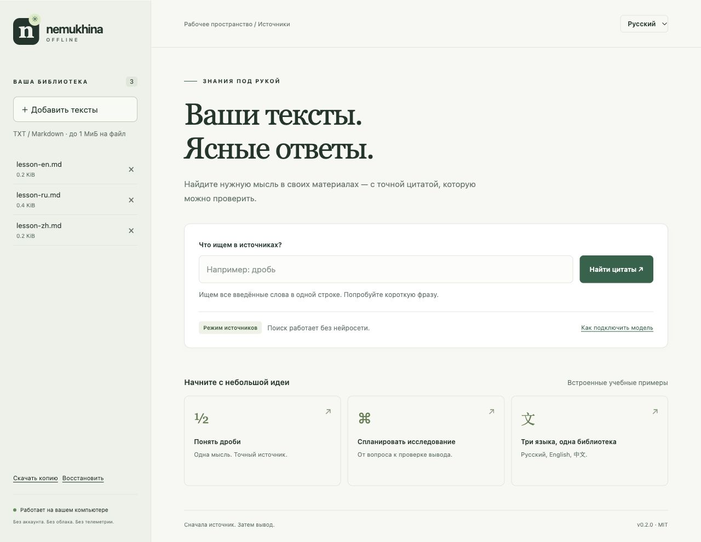

# Nemukhina Offline

**Ваши тексты. Проверяемые цитаты. На вашем компьютере.**

Небольшое локальное рабочее пространство для учёбы и работы с источниками. Добавьте текст, найдите нужную строку, откройте оригинал. Начать можно без модели, аккаунта и установки Python-пакетов.

[English](docs/README.en.md) · [中文](docs/README.zh.md) · [Проверки](docs/VALIDATION.md) · [Участие](CONTRIBUTING.md)

[](https://github.com/marinanemukhina-lgtm/nemukhina-offline/actions/workflows/test.yml)
[](LICENSE)



## Попробуйте за минуту

Нужен установленный **Python 3.10+** (3.9 также проверен локально, но уже устарел). [Скачайте исходники ZIP](https://github.com/marinanemukhina-lgtm/nemukhina-offline/archive/refs/heads/main.zip), распакуйте и откройте терминал в папке проекта:

```sh
python3 server.py
```

В Windows: `py -3 server.py` или `start.bat`. На macOS/Linux также можно запустить `./start.command` из терминала. Откройте **http://127.0.0.1:8765** в браузере и нажмите **«Понять дроби»**. Синтетический пример добавится в библиотеку, а результат покажет точную цитату. Нажмите на имя источника, чтобы прочитать оригинал с номерами строк.

Первое скачивание проекта и Python требует сети. После этого поиск и интерфейс работают локально: в приложении нет внешних шрифтов, CDN, аккаунтов или запросов к облачному API. Значки в этом GitHub README загружаются с внешних сайтов; локальное приложение их не использует.

## Что уже работает

- **Точная цитата вместо догадки.** Имя файла, номер строки и SHA-256 рядом с результатом; оригинал открывается в один клик.
- **Ваши источники остаются локально.** Импорт только выбранных UTF-8 TXT/Markdown. Никакого сканирования домашней папки.
- **Резервная копия без потери текущих текстов.** JSON-экспорт и восстановление с проверкой хешей. Восстановление объединяет документы, а не стирает библиотеку.
- **Русский, English, 中文.** Переключаемый интерфейс и учебные примеры на трёх языках.
- **Локальная модель по желанию.** Школьный, университетский и общий режимы; ответ строится по найденным источникам. Нейросеть без источников не запускается.
- **Прозрачный небольшой код.** Python + SQLite + обычный HTML/CSS/JS. Нет зависимостей для запуска, сборки фронтенда и облачной учётной записи.

## Подключить модель

Генерация **экспериментальная**. Заранее установите [llama.cpp](https://github.com/ggml-org/llama.cpp) из официального источника и скачайте совместимую GGUF-модель с подходящей лицензией. Приложение ничего не скачивает автоматически.

```sh
python3 server.py --engine /path/to/llama-completion --model /path/to/model.gguf
```

Используется встроенный chat template модели через `--jinja --single-turn`. Проверенный движок: llama.cpp build **12110**, commit `cd959bae9`. Старые сборки и `llama-cli` могут иметь другие параметры. Все файлы библиотек из архива движка следует оставить рядом с исполняемым файлом.

Реальный smoke-прогон Qwen2.5-0.5B-Instruct Q4_K_M на macOS ARM64 прошёл при **запрете всей сети средствами ОС**: ответы на трёх языках получены. Но модель пропустила ссылки в **3 из 3** ответов. Это тест работоспособности, не рекомендация этой маленькой модели для обучения. Приложение предупреждает о пропущенных или несуществующих номерах ссылок; оно не умеет автоматически доказывать истинность ответа. [Полные результаты и воспроизведение →](docs/VALIDATION.md)

## Границы возможностей

| Возможность | Текущее поведение |
|---|---|
| Поиск | Все слова запроса в одной строке, без учёта регистра; части слов допустимы. Не семантический поиск и не перевод. |
| Файлы | UTF-8 TXT/MD, до 1 МиБ каждый; 200 документов / 50 МиБ текста всего. |
| Импорт в браузере | До 8 МиБ JSON за запрос; большие группы разделяйте. Резервные копии принимаются до 320 МиБ JSON. |
| Результаты | До 20 точных строк; порядок по имени файла и строке, без ранжирования релевантности. |
| Генерация | До 512 токенов / 180 секунд. Промпт до 12 000 байт; фактическая вместимость зависит от токенизации модели. |
| Хранение | `data/library.sqlite3` в текущей папке; можно выбрать `--db /path/library.sqlite3`. Без шифрования. |
| Пока нет | PDF/OCR, EPUB/ZIM, голоса, фоновых действий, энциклопедии, подписанного установщика. |

Сервер слушает только `127.0.0.1`. Это приложение для одного пользователя на своём компьютере, не публичный хостинг. Доступ к API защищён токеном сессии и проверками Host/Origin, но это не защита от вредоносных локальных программ. Резервные копии содержат ваши тексты — храните их вне репозитория. [Подробные границы безопасности](SECURITY.md).

## CLI и проверка

```sh
python3 offline.py import examples/lesson-ru.md examples/lesson-en.md examples/lesson-zh.md
python3 offline.py search 'дробь'
python3 offline.py --lang en search 'fraction'
python3 offline.py --lang zh search '分数'
python3 -m unittest discover -s tests -v
```

Дополнительные команды: `python3 offline.py --help`, `python3 server.py --help`. Для смены порта: `python3 server.py --port 8766`. Чтобы остановить сервер, нажмите Ctrl+C в терминале. Для копирования SQLite-файла сначала остановите все процессы приложения; JSON-копию можно скачать во время работы.

## Помочь проекту

Попробуйте конкретную задачу и расскажите, где стало неудобно. Особенно полезны ошибки на синтетических примерах, проверка доступности и улучшение переводов. [Как внести вклад](CONTRIBUTING.md) · [План развития](docs/ROADMAP.md) · [История изменений](CHANGELOG.md).

Если проект оказался полезен, звезда поможет другим его найти. Мы не покупаем звёзды и не обещаем готовность функций, которые ещё не проверены.

Независимая реализация под MIT; синтетические примеры созданы для проекта. Веса и чужие библиотеки знаний не распространяются. [Сравнение с Survival LLM и происхождение](docs/COMPARISON.md).
